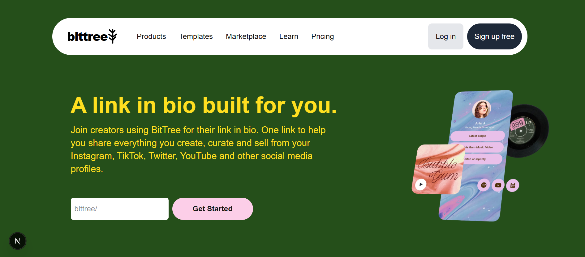

# 🌳 BitTree - Your Link Sharing Hub

BitTree is a full-stack link-in-bio web app where anyone can create a personal page with a custom handle, a profile picture, a short description, and all their important links (GitHub, YouTube, Instagram, website and more) in one place.

🔗 **Live Demo:** [bit-tree-eight.vercel.app](https://bit-tree-eight.vercel.app)

---

## 📸 Screenshot



---

## 🚀 Features

- **Custom handles:** Choose a handle and get your own page at `/your-handle`
- **Add multiple links:** Add link text and URL pairs to build your list
- **Profile picture and description:** Personalize your page with an image link and a short bio
- **Dynamic profile pages:** Each handle gets its own page, generated with the Next.js App Router
- **Database storage:** Profile data and links are stored in MongoDB
- **API routes:** Backend logic is handled with Next.js API routes
- **Toast notifications:** Instant feedback with React Toastify when your BitTree is generated
- **Fully responsive:** Works on mobile, tablet, and desktop screens

---

## 🛠️ Built With

- **Framework:** Next.js (App Router)
- **Frontend:** React, JavaScript
- **Styling:** Tailwind CSS
- **Database:** MongoDB (official Node.js driver)
- **Notifications:** React Toastify
- **Deployment:** Vercel

---

## 📦 Installation & Setup

1. Clone the repository:
   ```bash
   git clone https://github.com/aiyu-dev/BitTree.git
   ```
2. Go into the project folder:
   ```bash
   cd BitTree
   ```
3. Install dependencies:
   ```bash
   npm install
   ```
4. Create a `.env` file in the root folder and add your MongoDB connection string:
   ```env
   MONGODB_URI=your_mongodb_connection_string
   ```
5. Start the development server:
   ```bash
   npm run dev
   ```
6. Open [http://localhost:3000](http://localhost:3000) in your browser.

---

## 📚 What I Learned

- Creating dynamic routes in the Next.js App Router
- Building API routes and connecting them to MongoDB
- Handling form data and state in React
- Styling a full page layout with Tailwind CSS
- Using environment variables to keep secrets out of the code
- Deploying a full-stack app on Vercel

---

## 🎯 Project Goal

I built this project to practice full-stack development and to learn how the frontend, API routes, and database work together in a Next.js app. It is a Linktree-inspired project build for learning purposes.

---

## 🎓 Credits

This project is based on [CodeWithHarry's](https://www.youtube.com/@CodeWithHarry) BitTree tutorial, which I followed to learn full-stack development with Next.js and MongoDB.

**My Enhancements:**
- Designed and built the second landing page section ("Create and customize your BitTree")
- Created the BitTree logo
- Designed and built the navbar
- Fixed errors and deployed the project on Vercel

Design inspiration from Linktree.

---

## 👩‍💻 Author

*Ayesha Shahzad*
Frontend Developer | Computer Science Student

- GitHub: [aiyu-dev](https://github.com/aiyu-dev)

⭐ If you like this project, consider giving it a star!